# System Architecture Sequence Diagrams

> **CISTAC 1.0 (AI4Brain Challenge)** — 5-Subsystem Interoperability & Closed-Loop Protocol  
> **Source of Truth**: Root `README.md` · `docs/ui/contracts.md` · `assessment_engine/`

---

## 1. High-Level Closed-Loop Overview

The SynapseTwin platform operates as a closed-loop system across 5 decoupled sub-modules:

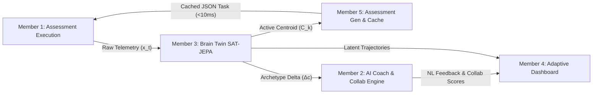

---

## 2. Sequence Diagram 1: Assessment Execution & Telemetry Streaming (Member 1 → Member 3)

Captures non-biometric behavioral telemetry ($x_t$) without UI blocking, buffers local events during network drops, and flushes to the ingestion queue.

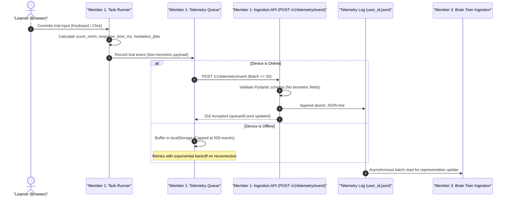

---

## 3. Sequence Diagram 2: Latent Representation Encoding & Task Blueprints Cache (Member 3 → Member 5)

Encodes telemetry into continuous latent representations via SAT-JEPA, anchors into 9 GMM archetypes with Schmitt-trigger hysteresis, and projects parameters into the cache pool.

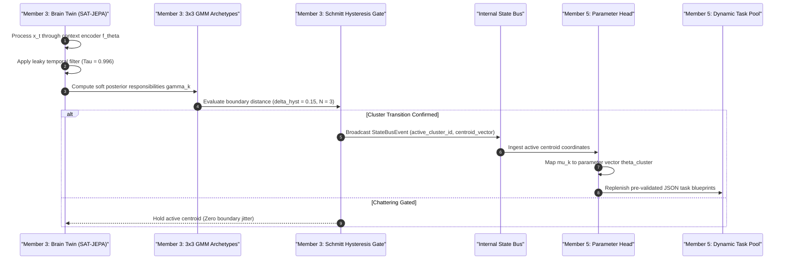

---

## 4. Sequence Diagram 3: State Transition & Prototype Explainability XAI (Member 3 → Member 2)

Ingests the prototype differential vector ($\Delta c$) to justify task pacing and generate non-clinical natural language explanations.

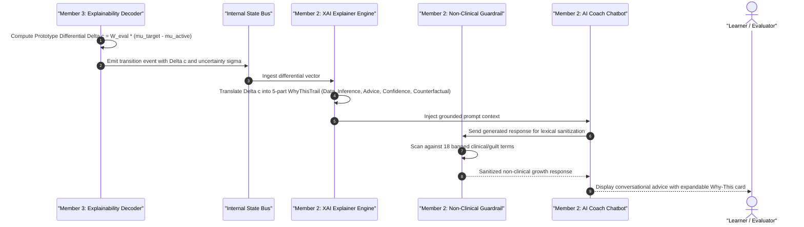

---

## 5. Sequence Diagram 4: Low-Latency Task Next & Runtime Adaptive Execution (Member 5 → Member 1)

Delivers pre-validated assessment JSON to the client in under 10 ms, verifies anti-repeat via Bloom filter, and executes client-side staircase adaptation.

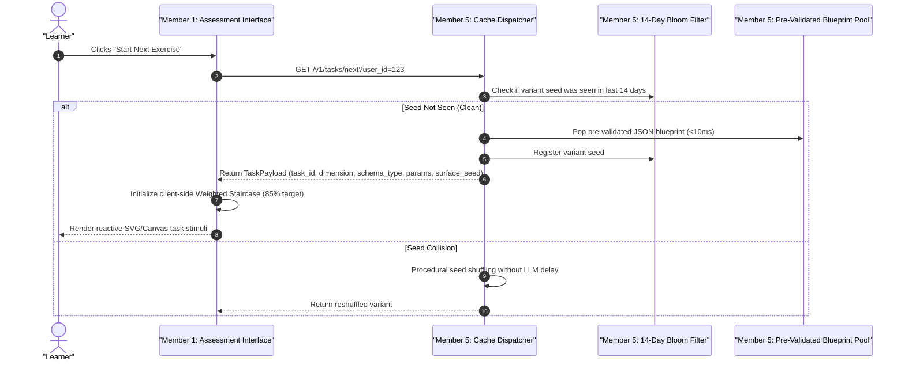

---

## 6. Sequence Diagram 5: Profile Ingestion, Radar Chart & Dashboard Analytics (Members 3 & 2 → Member 4)

Aggregates longitudinal profile estimates, confidence intervals, predictive ribbons, and AI collaboration scores into the visual analytics dashboard.

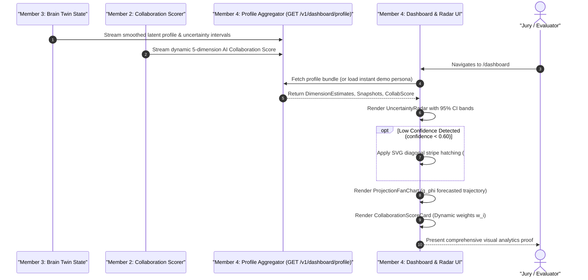

---

## 7. Consumer UX, Behavioral Adaptation & Governance Flows

### Diagram 1: End-to-End User UX Flow (First Click to De-Cluttered Dashboard)

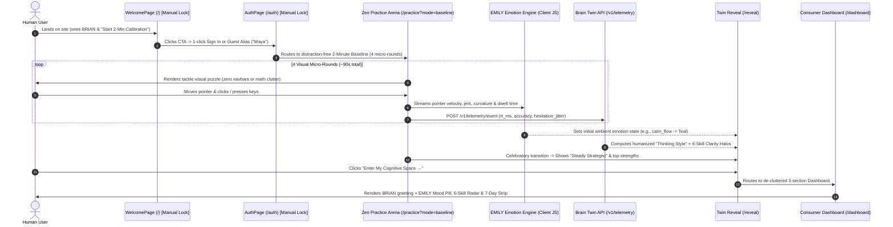

---

### Diagram 2: EMILY Behavioral Emotion Tracking & Human-Approved Color Adaptation

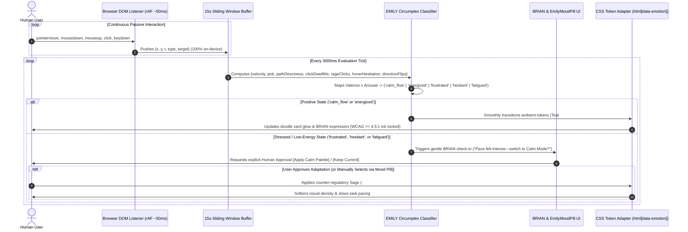

---

### Diagram 3: Assessment Telemetry, Brain Twin (SAT-JEPA + 3x3 GMM), and <10ms Task Cache

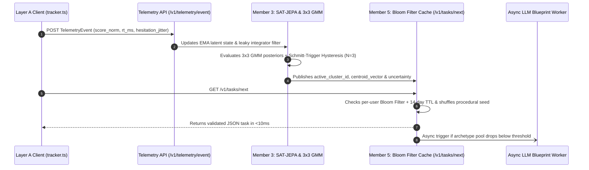

---

### Diagram 4: Explainable AI Coach, Non-Clinical Firewall & Dynamic Collaboration Scorer

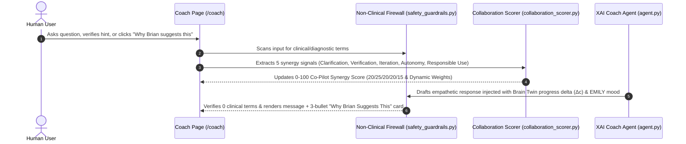

---

### Diagram 5: Human-in-the-Loop UX Review & Jargon Gate Workflow (?review_mode=true)

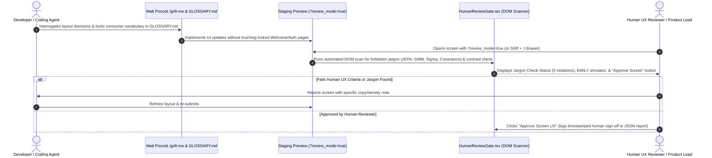
```

