# System Architecture Sequence Diagrams

> **What is built (2026-10-31).** Sections 1–6 are the original challenge design (see [TEAM_PLAN.md](TEAM_PLAN.md)), not the running system. Live today in `backend/app`: telemetry ingest (`POST /v1/telemetry/event`), export (`GET /v1/user/export`) and delete (`DELETE /v1/user/telemetry`). These answer 501 until their ticket lands: `GET /v1/tasks/next` (BE-04), `POST /v1/coach/chat` and `GET /v1/coach/collaboration-score` (BE-06), `POST /v1/clustering/evaluate` (BE-11); `GET /v1/dashboard/profile` returns `not_enough_data` until BE-11. Section 7 describes the current consumer flows.
>
> **Source of truth**: `backend/app` · [`docs/ui/contracts.md`](../ui/contracts.md) · the root [`README.md`](../../README.md)  
> 🚀 **Interactive Visual Viewer**: Open [`sequence_diagrams_viewer.html`](./sequence_diagrams_viewer.html) in any browser to zoom, pan, inspect and export the 8 rendered diagrams. Section 7's diagrams 1, 2 and 4 were rewritten for brand v2 on 2026-10-31 and render from their Mermaid source only (GitHub draws them inline).

---

## 1. High-Level Closed-Loop Overview

The SynapseTwin platform operates as a closed-loop system across 5 decoupled sub-modules:


> 📊 **Rendered Visual Diagram**: [🔍 Open Vector SVG](./diagrams/01-high-level-closed-loop.svg) · [🖼️ View High-DPI Retina PNG](./diagrams/01-high-level-closed-loop.png)

<details open>
<summary><b>Mermaid Diagram Specification & Code</b></summary>

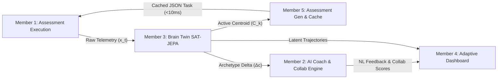

</details>

---

## 2. Sequence Diagram 1: Assessment Execution & Telemetry Streaming (Member 1 → Member 3)

Captures non-biometric behavioral telemetry ($x_t$) without UI blocking, buffers local events during network drops, and flushes to the ingestion queue.

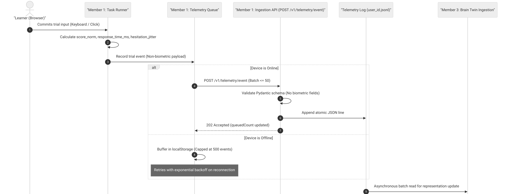

> 📊 **Rendered Visual Diagram**: [🔍 Open Vector SVG](./diagrams/02-seq1-assessment-telemetry-streaming.svg) · [🖼️ View High-DPI Retina PNG](./diagrams/02-seq1-assessment-telemetry-streaming.png)

<details open>
<summary><b>Mermaid Diagram Specification & Code</b></summary>

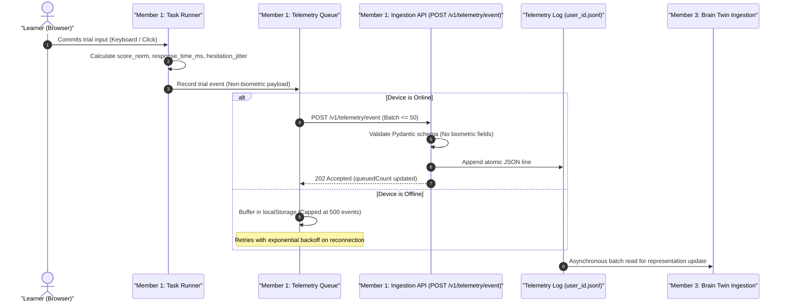

</details>

---

## 3. Sequence Diagram 2: Latent Representation Encoding & Task Blueprints Cache (Member 3 → Member 5)

Encodes telemetry into continuous latent representations via SAT-JEPA, anchors into 9 GMM archetypes with Schmitt-trigger hysteresis, and projects parameters into the cache pool.

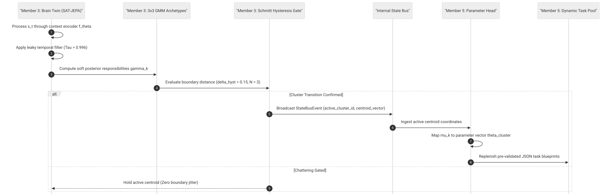

> 📊 **Rendered Visual Diagram**: [🔍 Open Vector SVG](./diagrams/03-seq2-latent-representation-encoding.svg) · [🖼️ View High-DPI Retina PNG](./diagrams/03-seq2-latent-representation-encoding.png)

<details open>
<summary><b>Mermaid Diagram Specification & Code</b></summary>

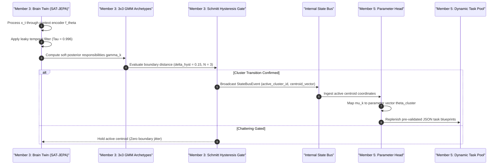

</details>

---

## 4. Sequence Diagram 3: State Transition & Prototype Explainability XAI (Member 3 → Member 2)

Ingests the prototype differential vector ($\Delta c$) to justify task pacing and generate non-clinical natural language explanations.

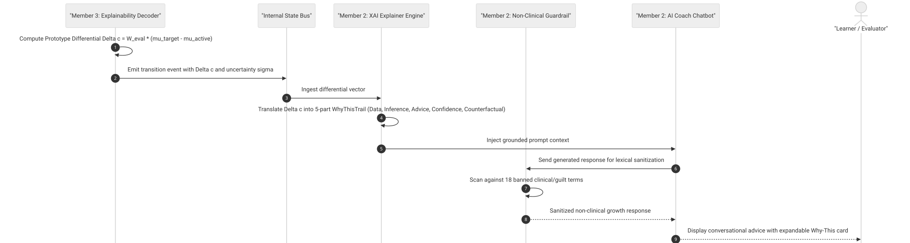

> 📊 **Rendered Visual Diagram**: [🔍 Open Vector SVG](./diagrams/04-seq3-prototype-explainability-xai.svg) · [🖼️ View High-DPI Retina PNG](./diagrams/04-seq3-prototype-explainability-xai.png)

<details open>
<summary><b>Mermaid Diagram Specification & Code</b></summary>

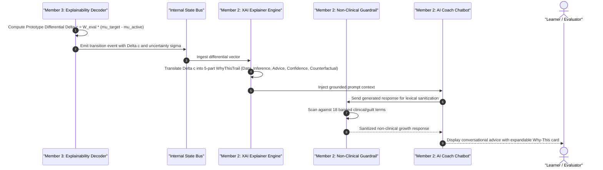

</details>

---

## 5. Sequence Diagram 4: Low-Latency Task Next & Runtime Adaptive Execution (Member 5 → Member 1)

Delivers pre-validated assessment JSON to the client in under 10 ms, verifies anti-repeat via Bloom filter, and executes client-side staircase adaptation.

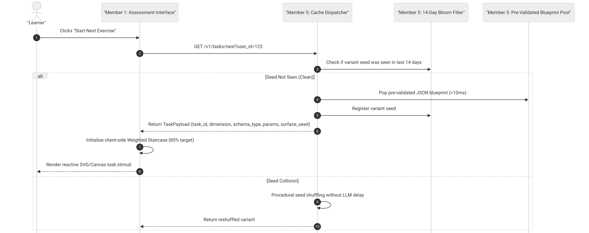

> 📊 **Rendered Visual Diagram**: [🔍 Open Vector SVG](./diagrams/05-seq4-low-latency-task-cache.svg) · [🖼️ View High-DPI Retina PNG](./diagrams/05-seq4-low-latency-task-cache.png)

<details open>
<summary><b>Mermaid Diagram Specification & Code</b></summary>

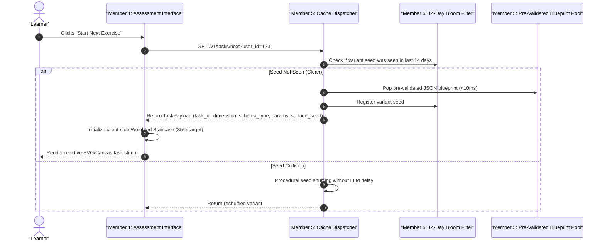

</details>

---

## 6. Sequence Diagram 5: Profile Ingestion, Radar Chart & Dashboard Analytics (Members 3 & 2 → Member 4)

Aggregates longitudinal profile estimates, confidence intervals, predictive ribbons, and AI collaboration scores into the visual analytics dashboard.

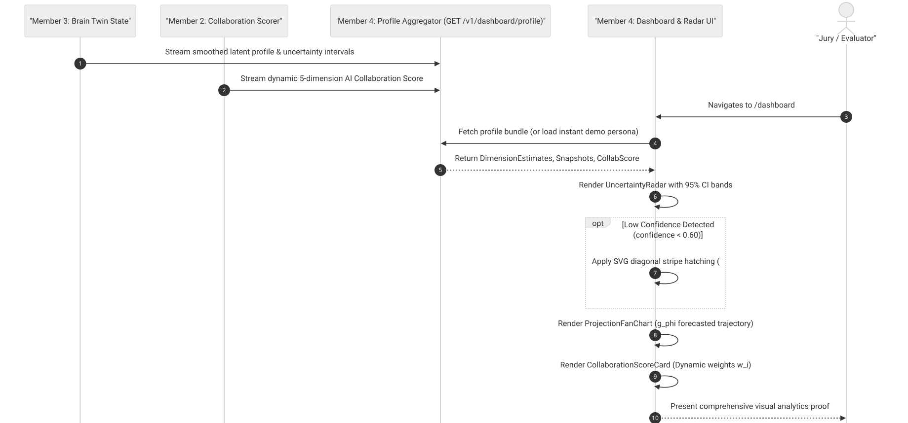

> 📊 **Rendered Visual Diagram**: [🔍 Open Vector SVG](./diagrams/06-seq5-profile-ingestion-dashboard.svg) · [🖼️ View High-DPI Retina PNG](./diagrams/06-seq5-profile-ingestion-dashboard.png)

<details open>
<summary><b>Mermaid Diagram Specification & Code</b></summary>

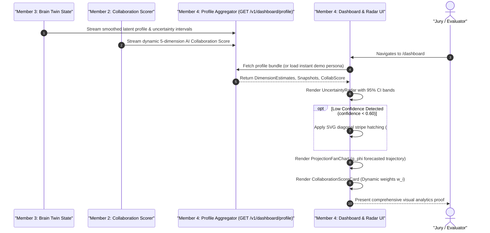

</details>

---

## 7. Consumer flows (brand v2), mood guess, coach and review

### Diagram 1: First visit (Welcome → Baseline → Results → Home)

```mermaid
sequenceDiagram
    autonumber
    actor User
    participant Welcome as Welcome (/)
    participant Baseline as Baseline (/baseline)
    participant Device as This device (taskScores, pillars, sessionStore)
    participant Results as Results (/results)
    participant API as Server (backend/app)
    participant Home as Home (/dashboard)

    User->>Welcome: Opens the app (Loti says hi, one button: Start)
    Welcome->>Baseline: Start
    loop 6 exercises (Logic Web, Memory Gauntlet, Color Clash, Strategic Blueprint, Perceptual Radar, Precision Archive)
        Baseline->>User: Instruction, fixation "+", trials, end card
        User->>Baseline: Answers
        Baseline->>Device: Queues one telemetry event per trial (nothing sent yet)
    end
    Baseline->>Device: Scores the run and saves a session
    Baseline->>Results: Blurred 5-skill chart, then the Dolphin
    Results->>User: Save my answers / Keep them on this device only (equal weight)
    alt Save my answers
        Results->>API: POST /v1/telemetry/event (the queued events)
    else Keep them on this device only
        Results->>Device: Clears the queue; nothing is sent
    end
    Results->>Home: Go to my space
    Home->>User: Greeting, Momo, one Loti line, Start today's session, 5-skill chart
```

A returning device (at least one saved session) skips Welcome and the baseline and opens Home.

---

### Diagram 2: Momo's mood guess (on the device only)

See [EMILY](EMILY_BEHAVIORAL_EMOTION_ENGINE.md) and [ADR 0002](../adr/0002-no-server-side-emotion-inference.md).

```mermaid
sequenceDiagram
    autonumber
    actor User
    participant Listener as EmotionListener (app shell)
    participant Rules as emilyEngine.ts (hand-written rules)
    participant Store as useEmilyStore
    participant Momo as Momo (Home)

    loop While the user moves, taps and types
        User->>Listener: pointer, click and key events (kept in the browser)
    end
    loop Every 3 s
        Listener->>Rules: Sliding window of events
        Rules->>Store: A guess: calm_flow, energized, frustrated, hesitant or fatigued
        alt calm_flow or energized
            Store->>Momo: Calm or happy
        else Strained guess with task strain (rage clicks, or 2+ errors when reported)
            Store->>Momo: Proposed only; the user approves it or keeps the current mood
        end
    end
    User->>Store: Picks a mood (locks it until unlocked)
    Note over Listener,Momo: No mood label, buffer or metric is sent to the server.
```

---

### Diagram 3: Assessment Telemetry, Brain Twin (SAT-JEPA + 3x3 GMM), and <10ms Task Cache

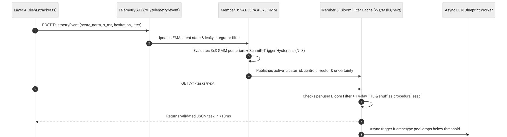

> 📊 **Rendered Visual Diagram**: [🔍 Open Vector SVG](./diagrams/09-telemetry-jepa-cache.svg) · [🖼️ View High-DPI Retina PNG](./diagrams/09-telemetry-jepa-cache.png)

<details open>
<summary><b>Mermaid Diagram Specification & Code</b></summary>

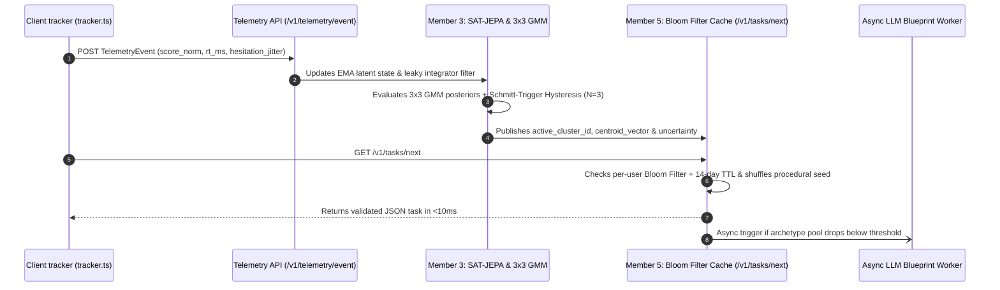

</details>

---

### Diagram 4: Loti, the crisis gates and the optional AI mode

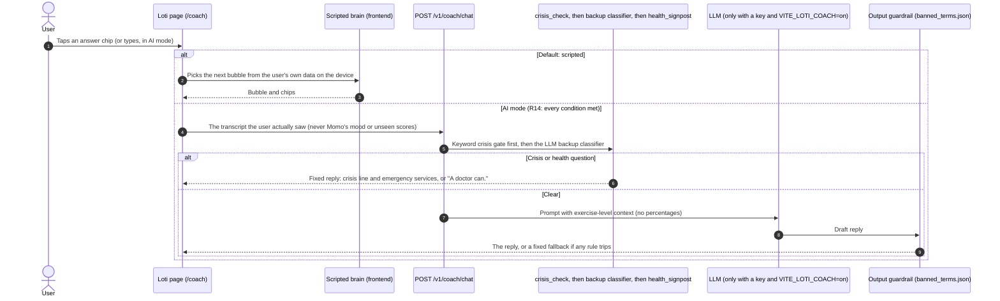

`POST /v1/coach/chat` answers 501 until BE-06 ships it. The Collaboration Score (`GET /v1/coach/collaboration-score`, also 501 until BE-06) will be computed from real chat history only, and will appear only in Home's "Further explore" when there is enough data (BE-06/F-C).

---

### Diagram 5: Human-in-the-Loop UX Review & Jargon Gate Workflow (?review_mode=true)

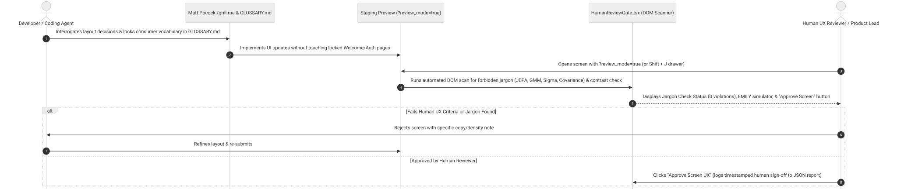

> 📊 **Rendered Visual Diagram**: [🔍 Open Vector SVG](./diagrams/11-human-ux-review-jargon-gate.svg) · [🖼️ View High-DPI Retina PNG](./diagrams/11-human-ux-review-jargon-gate.png)

<details open>
<summary><b>Mermaid Diagram Specification & Code</b></summary>

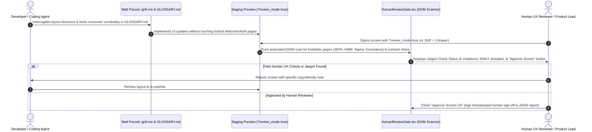

</details>