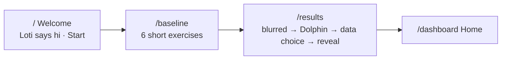

# SynapseTwin brand v2: design and routing

This is the current design and route map of the web app (`frontend/`). The binding spec, with every rule and ruling, is `.scratch/brand-v2/spec.md`. This file is the short version for anyone opening the code.

## 1. Design in one paragraph

A calm, friendly training app on a **classroom board**. The page is a wooden frame, and the app sits on the board inside it: a dotted whiteboard in light mode, a green chalkboard in dark mode. The palette is sky blue with coral accents. Headings are Quicksand (20 px and up only) and text is Inter. Buttons are pills, and there is one soft shadow. Three characters carry the emotion, so the screens don't have to: **Loti** (axolotl coach), **Dolphin** (celebrations) and **Momo** (mood). Every screen shows only what you need right now.

## 2. Rules that shape every screen

| Rule | What it means in practice |
|---|---|
| **Need-to-know only** (anti-slop rule 13) | At most 3 blocks above the fold. Paragraphs of 2 lines or fewer. Details go behind one quiet "More". About 60 visible words above the fold (Welcome ≤ 40); tests enforce this. |
| **Few buttons** (rule 14) | One primary button per screen, plus at most 2 quiet controls. Inside an exercise there are only answer controls plus Pause/Exit. |
| **Consumer words** | No technical, clinical or brain-region claims in the UI. `npm run lint:copy` enforces it. Formulas live only on `/methodology`. |
| **Honest numbers** | Scores come only from your own sessions. Missing data shows "—" or "Not measured yet", never a made-up value. |
| **Motion with meaning** (R8) | Entrances, celebrations and state changes only. Under reduced motion, all of it is off. Nothing moves near a stimulus during a trial. |
| **Tokens only** | Colours, spacing and durations come from `src/styles/tokens.css`. `lint:tokens` blocks raw values, and `check:contrast` audits every colour pair. |

## 3. Visual system (where to change it)

| Piece | File |
|---|---|
| Colours, wood frame, board, dot grid, radii, motion | `frontend/src/styles/tokens.css` |
| Contrast pairs (audited) | `frontend/src/styles/token-metadata.ts` |
| Characters (SVG, poses) | `frontend/src/components/features/characters/{Loti,Dolphin,Momo}.tsx` |
| App shell: header, 4 tabs, footer, judge tools | `frontend/src/components/layout/AppShell.tsx` |
| Mood listener (feeds Momo) | `frontend/src/components/layout/EmotionListener.tsx` |

**Board background.** `body` is the wood (`--color-wood`). `#root` is the board (`--color-canvas` plus the dot grid, rounded and clipped). Don't paint an opaque page background inside `#root`, or it hides the board. In dark mode the cards (`--color-surface`, `-raised`, `--color-border`, `--color-brand-subtle`) are green slate, the chalkboard's own hue; a test keeps them within 30° of it.

**Theme on load.** An inline script in `index.html` applies the stored theme (`synapsetwin_theme_v1`) before the first paint, so a reload never flashes light. There is no CSP today; if one is added, allow that script by its hash.

## 4. Routing

### Navigation
Four tabs: **Home · Train · Loti · You**. On desktop they sit in the header; below `lg` they become bottom tabs inside the wood frame. **You** stays active on `/privacy`, `/settings` and `/methodology`.

### First visit flow

Returning devices (at least one saved session) go straight to Home: `/` and `/baseline` redirect to `/dashboard` (`/baseline?again=1` is the retake).

### Route map

| Route | Page | What it shows (above the fold) | Main files |
|---|---|---|---|
| `/` | Welcome | Loti greeting, one line, **Start** | `pages/WelcomePage.tsx` |
| `/baseline` | Baseline | 6 exercises in a row with a "1 of 6" bar: Logic Web, Memory Gauntlet, Color Clash, Strategic Blueprint, Perceptual Radar, Precision Archive | `pages/BaselinePage.tsx`, `features/flow/baseline.ts` |
| `/results` | Results | Blurred 5-skill chart → Dolphin → **Save my answers** / **Keep them on this device only** (equal weight) → reveal → **Go to my space** | `pages/ResultsPage.tsx`, `features/flow/LoginSheet.tsx` |
| `/dashboard` | Home | Greeting + Momo + one Loti line, **Start today's session**, 5-skill chart (+ "View as table"). Below: progress curve, then "Further explore my training" (heatmap, goals, why Loti picked this) | `pages/DashboardPage.tsx`, `features/insights/*` |
| `/train` | Train | Loti line; 5 skills, each listing its exercises; one primary Start on the weakest skill (the same weakest as Home and Loti: `weakestPillar` in `features/insights/dashboard.ts`). `?pillar=<id>` focuses a skill | `pages/TrainPage.tsx`, `features/train/catalog.ts` |
| `/task/:dimId?schema=<type>` | Exercise | One exercise in the exercise frame: Exit and Begin on the instruction screen, Pause from Begin on; the end card returns to Train | `pages/TaskRunnerPage.tsx`, `features/assessment/*` |
| `/coach` | Loti | The conversation (resumes where you left off), answer chips, quiet "Start over" | `pages/CoachPage.tsx`, `features/loti/*` |
| `/you` | You | Your name ("Guest"), then Privacy · Settings · How we calculate this. No sign-in row (R13) | `pages/YouPage.tsx` |
| `/privacy` | Privacy | Consent status + change, what we record (one sentence), Export my data, Delete my data | `pages/PrivacyPage.tsx`, `features/privacy/myData.ts` |
| `/settings` | Settings | Theme, Reduce motion | `pages/SettingsPage.tsx` |
| `/methodology` | How we calculate this | Plain intro; 5 closed topics with the real formulas and constants, imported from code | `pages/MethodologyPage.tsx` |
| `/offline`, `/system-error`, `*` | System | Loti, one line, one way home | `pages/SystemPage.tsx` |

The Welcome, Baseline and Results pages use minimal chrome: logo and theme toggle only, no tabs.

### Old addresses (redirects, query string kept)
`/onboarding`, `/auth`, `/login`, `/sign-in`, `/register` and `/create-account` → `/` · `/practice` → `/baseline` · `/assessment`, `/plan` and `/task` → `/train` · `/profile-reveal` and `/reveal` → `/results` · `/goals`, `/brain-twin`, `/collaboration`, `/layer-d` and `/design-system` → `/dashboard` · `/dimensions/*` → `/you`. The list lives in `REDIRECTS` in `frontend/src/App.tsx`. A test fails if app code links to a redirected route.

### Flags in the URL
- `?judge=1`: evaluator tools (stage, preset and inspector controls). The flag is remembered for the tab, and `?judge=0` clears it. Without it, none of those tools render.
- `?fast=1`: shortens the baseline to seconds. It only works in test builds (`VITE_E2E=1`) with mock tasks.

## 5. Exercises

| Code | Name | Skill (pillar) |
|---|---|---|
| relational | Logic Web | Focus & Strategy |
| tower | Strategic Blueprint | Focus & Strategy |
| matrix | Pattern Puzzle | Focus & Strategy |
| n_back | Memory Gauntlet | Mental Agility |
| mental_rotation | Shape Turn | Mental Agility |
| stroop | Color Clash | Impulse Control |
| mst | Precision Archive | Deep Memory |
| ufov | Perceptual Radar | Visual Radar |

Every exercise runs inside `ExerciseFrame`, in four steps:
1. **Instruction:** name, how to play, animated example, Begin.
2. **Fixation:** a "+" for 500 ms.
3. **Trials:** progress dots only, no decoration.
4. **End card.**

Hiding the tab during the fixation or the trials pauses the run. A paused attempt is never scored or sent.

## 6. Data and privacy (what the screens rely on)
- **Scores are computed on the device.** `features/insights/taskScores.ts` → `pillars.ts` → `sessionStore.ts` (`synapsetwin_sessions_v1`).
- **Telemetry stays on the device until you choose "Save my answers".** The tracker is `features/assessment/telemetry/tracker.ts`. Choosing "Keep them on this device only" sends nothing and clears the queue.
- **Users are anonymous** (R13): no accounts.
- **Export my data** downloads everything the device holds. **Delete my data** clears it and keeps your theme and reduce-motion settings.
- **Server:** `backend/app` (FastAPI) combines our backend work with Hamza's:
  - **Hamza's base:** the app, the `/v1` routes, Docker, and the scoring library (IRT, EZ-diffusion, Kalman + RCI, SSRT, 85% difficulty rule).
  - **Our modules:** telemetry ingest, privacy (export, delete, 30-day retention), task generators (`dynamic_cache/`), coach safety (`ai_coach/`) and synthetic data (`data/synthetic/`).
  - Endpoints that aren't built yet answer "not available yet".

## 7. Rulings that changed the design (dated 2026-10-31)
- **R8:** livelier Welcome and exercise screens, with motion outside the trials only.
- **R9:** the fixation "+" appears instantly.
- **R10:** the baseline has 6 exercises, with Color Clash 3rd.
- **R11:** no "If you pause" line and no idle penalty; the projection shows from session 3.
- **R12:** score ranges appear only in "View as table"; no projection bands.
- **R13:** stay anonymous.
- **R14:** no AI-generated Loti replies for users until a second, AI-based crisis check exists.
- **R15:** (server) unbuilt endpoints answer "not available yet" instead of inventing data.
- **R16:** Memory Gauntlet scoring follows its hint: only the current rule's stream expects an answer.
- **Background:** the classroom board.

The decision record is **DEC-011** in `docs/ui/DECISIONS.md` (supersedes DEC-010, and DEC-007 for these pages).

## 8. Checks
```
cd frontend
npm run qa:checks        # lint:tokens, lint:copy, check:contrast, vitest, build
npx playwright test      # e2e (axe in light and dark at 375/768/1440, no overflow, word budgets)
```
The repo config uses the Chrome channel. On a machine without Chrome, run the same specs through a local config with `channel: 'msedge'`. Screenshots in `docs/ui/screenshots/` come from these specs when the shot folders (`SHOTS_DIR`, `FLOW_SHOT_DIR`, `DASH_SHOT_DIR`, `TRAIN_SHOTS_DIR`) point there.
